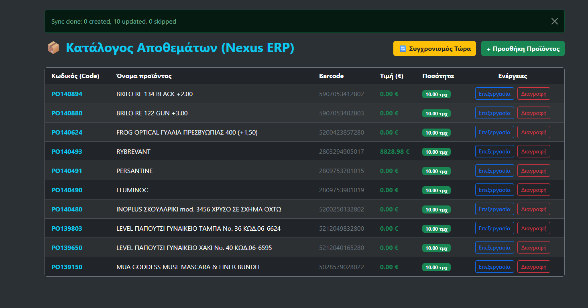

# NexusERP

A Django inventory management app that keeps a local product catalogue in sync with an external ERP REST API. It combines a server-rendered dashboard for managing stock by hand with a JSON API for other systems to read from.

> **Status:** working MVP, under active development. See the [Roadmap](#roadmap) for what's next.

<!-- Screenshots: add images to docs/screenshots/ and link them here, e.g.
 -->

## Features

- **Product management (CRUD):** create, edit and delete products through Django forms with server-side validation (for example, prices can't be negative).
- **External API sync:** pulls items from a SoftOne/CloudOn ERP endpoint and inserts or updates them locally with `update_or_create`, matched on product code. Running it twice doesn't create duplicates.
- **REST API:** a Django REST Framework endpoint that returns the catalogue as JSON.
- **Dashboard UI:** dark-themed Bootstrap interface with stock badges (in stock / out of stock). The interface is in Greek.

## Tech stack

| Area | Technology |
|---|---|
| Language | Python 3.12+ |
| Framework | Django 6.0 |
| API | Django REST Framework 3.17 |
| HTTP client | requests |
| Database | SQLite (development) |
| Front end | Django templates + Bootstrap 5 |

## Getting started

```bash
git clone https://github.com/EllieK-coder/NexusERP.git
cd NexusERP

python -m venv .venv
# Windows:      .venv\Scripts\activate
# macOS/Linux:  source .venv/bin/activate

pip install -r requirements.txt
python manage.py migrate
python manage.py runserver
```

Open http://127.0.0.1:8000/. The database starts empty; press **Συγχρονισμός Τώρα** (Sync now) to load products from the external API, or add one by hand.

For the admin panel at `/admin/`, create a user first:

```bash
python manage.py createsuperuser
```

## Usage

| URL | Description |
|---|---|
| `/home/` | Dashboard |
| `/list/` | Product catalogue |
| `/add/` | Add a product |
| `/edit/<id>/` | Edit a product |
| `/delete/<id>/` | Delete a product (with confirmation) |
| `/sync/` | Import products from the external API |
| `/api/products/` | All products as JSON |
| `/admin/` | Django admin |

Example response from `GET /api/products/`:

```json
[
  {
    "id": 1,
    "code": "A100",
    "name": "Office chair",
    "price": "89.90",
    "quantity": "12.00",
    "barcode": "5201234567890",
    "description": "Ergonomic, adjustable height"
  }
]
```

## How the sync works

1. `GET` request to the external ERP endpoint (10-second timeout).
2. Reads the `data` array from the JSON response.
3. For each item, creates or updates the local product with the same `code`:
   - name comes from `name`, falling back to `description`;
   - price comes from `wholesalePrice`, falling back to `retailPrice`;
   - quantity comes from `qty`.
4. Network and HTTP errors are caught, so a failed sync doesn't crash the app.

## Project structure

```
NexusERP/
├── DjangoProject6/        # Project settings, root URLs, WSGI/ASGI
├── products/              # Main app
│   ├── models.py          # Product model
│   ├── forms.py           # ProductForm with validation
│   ├── views.py           # CRUD views, sync, API endpoint
│   ├── serializers.py     # DRF serializer
│   ├── urls.py
│   └── templates/products/
├── manage.py
└── requirements.txt
```

## Known limitations

These are tracked on the roadmap below.

- No authentication: anyone with access to the app can change or delete data.
- The sync is triggered by a `GET` request, and failures are only logged to the console, not shown to the user.
- The external API URL and the secret key are hardcoded in the code.
- Missing quantities from the external API default to 10.
- The REST API is read-only.
- No automated tests yet.

## Roadmap

### Phase 1 — Quality and reliability
- [ ] Unit tests for the model, form validation and views
- [ ] Tests for the sync with the external API mocked
- [ ] Rename the `DjangoProject6` settings package to `config`
- [ ] Move `SECRET_KEY`, `DEBUG` and the sync URL to environment variables (`.env`)
- [ ] Show sync results and errors to the user with Django messages ("12 updated, 3 created")

### Phase 2 — Security
- [ ] Login and logout with Django's built-in authentication
- [ ] Require login for all create, edit, delete and sync actions
- [ ] Make the sync a `POST` action with CSRF protection
- [ ] Token authentication for the API

### Phase 3 — A complete REST API
- [ ] Full CRUD API with DRF ViewSets and routers
- [ ] Filtering, search and pagination
- [ ] Auto-generated API docs (OpenAPI / Swagger UI with drf-spectacular)

### Phase 4 — Production readiness
- [ ] `python manage.py sync_products` management command, so the sync can run on a schedule
- [ ] PostgreSQL support
- [ ] Docker and docker-compose setup
- [ ] GitHub Actions workflow that runs the tests on every push
- [ ] Live demo deployment

### Phase 5 — ERP features
- [ ] Stock movement history (who changed what, and when)
- [ ] Low-stock alerts
- [ ] Product categories and suppliers
- [ ] Export the catalogue to CSV or Excel
- [ ] English interface option

## Author

Elianna Kalodimou — [@EllieK-coder](https://github.com/EllieK-coder)
