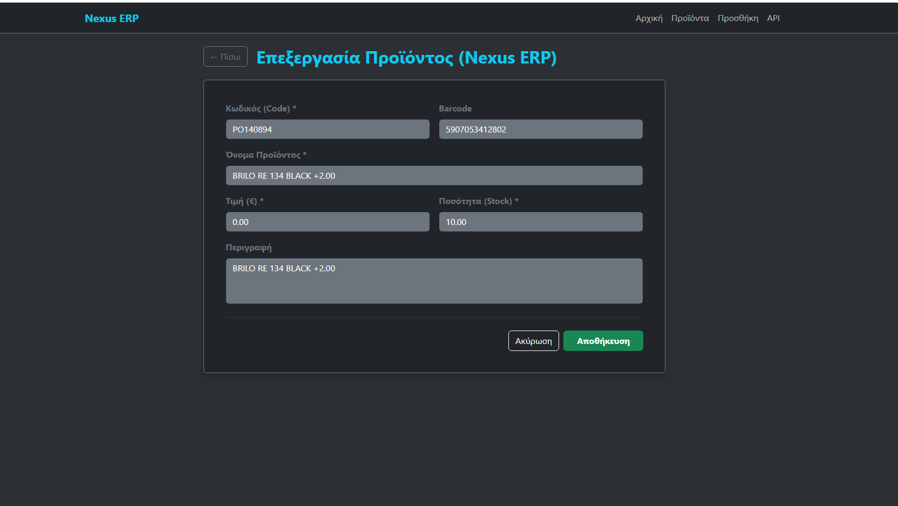

# Django Inventory Sync

[](https://github.com/EllieK-coder/django-inventory-sync/actions/workflows/tests.yml)

A Django inventory management app that keeps a local product catalogue in sync with an external ERP REST API. It combines a server-rendered dashboard for managing stock by hand with a JSON API for other systems to read from.
Started as a one-week technical assignment for an ERP software company, then extended into a full project with authentication, tests and CI.

> **Status:** working MVP, under active development. See the [Roadmap](#roadmap) for what's next.




## Features

- **Product management (CRUD):** create, edit and delete products through Django forms with server-side validation (for example, prices can't be negative).
pulls items from an ERP REST API (a built-in demo endpoint with 30 sample products is included)
- **REST API:** full CRUD for products with Django REST Framework (list, create, retrieve, update, delete), protected by token authentication. Prices are validated in the API too, not just in the web form.
- **Dashboard UI:** dark-themed Bootstrap interface with stock badges (in stock / out of stock). The interface is in Greek.
- **Automated tests:** 32 tests covering models, form validation, views, the API and the sync (with the external API mocked), run on every push by GitHub Actions.

## Tech stack

| Area | Technology |
|---|---|
| Language | Python 3.12+ |
| Framework | Django 6.0 |
| API | Django REST Framework 3.17 |
| HTTP client | requests |
| Database | SQLite (development) |
| Front end | Django templates + Bootstrap 5 |
| Configuration | python-dotenv (`.env` file) |
| Testing & CI | Django test framework, unittest.mock, GitHub Actions |
| API docs | drf-spectacular (OpenAPI 3, Swagger UI) |

## Getting started


### Run with Docker

```bash
git clone https://github.com/EllieK-coder/django-inventory-sync.git
cd django-inventory-sync

python -m venv .venv
# Windows:      .venv\Scripts\activate
# macOS/Linux:  source .venv/bin/activate

pip install -r requirements.txt

# Create your local settings file from the template
# Windows:      copy .env.example .env
# macOS/Linux:  cp .env.example .env

python manage.py migrate
python manage.py runserver
```

Then open `.env` and set `DJANGO_SECRET_KEY` to a random value. The file explains how to generate one. The app won't start without it.

Open http://127.0.0.1:8000/. The app runs with gunicorn, and static files are served by whitenoise.
The SQLite database lives inside the container, so it resets when the container is removed.
For the admin panel at `/admin/`, create a user first:

```bash
python manage.py createsuperuser
   ### Using the API with a token

```bash
   # 1. Get a token
   curl -X POST -d "username=YOUR_USER&password=YOUR_PASSWORD" http://127.0.0.1:8000/api/token/

   # 2. Send it with every request
   curl -H "Authorization: Token YOUR_TOKEN" http://127.0.0.1:8000/api/products/
```

   Requests without a valid token get `401 Unauthorized`.
```

## Usage

| URL | Description |
|---|---|
| `/home/` | Dashboard |
| `/list/` | Product catalogue |
| `/add/` | Add a product |
| `/edit/<id>/` | Edit a product |
| `/delete/<id>/` | Delete a product (with confirmation) |
| `/sync/` | Import products from the external API | 
| `/api/products/` | API: list products (GET) or create one (POST). Requires a token or login |
| `/api/products/<id>/` | API: get (GET), update (PUT/PATCH) or delete (DELETE) one product |
| `/api/token/` | Get an API token (POST `username` and `password`) |
| `/api/docs/` | Interactive API documentation (Swagger UI), public |
| `/api/schema/` | OpenAPI 3 schema (YAML) |
| `/admin/` | Django admin |
| `/accounts/login/` | Log in (logout is a button in the navigation bar) |
| `/demo-erp/items/` | Demo ERP endpoint: ... |      ← last row of your table

### Query parameters for `/api/products/`

The API supports search, stock filtering, ordering and pagination (10 results per page).

| Parameter | Example | What it does |
|---|---|---|
| `search` | `?search=desk` | Searches code, name, barcode and description |
| `in_stock` | `?in_stock=true` | `true` = quantity above 0, `false` = quantity is 0 |
| `ordering` | `?ordering=-price` | Sorts by code, name, price or quantity (`-` = descending) |
| `page` | `?page=2` | Results come 10 per page |

Example response from `GET /api/products/`:

```json
{
  "count": 30,
  "next": "http://127.0.0.1:8000/api/products/?page=2",
  "previous": null,
  "results": [
    {
      "id": 1,
      "code": "A100",
      "name": "Office chair",
      "price": "89.90",
      "quantity": "12.00",
      "barcode": "5201234567890",
      "description": "Ergonomic, adjustable height"
    }
  ]
}
```
```

## Running the tests
  ruff check .                  # linting
  ruff format .                 # auto-format the code
  coverage run manage.py test   # tests with coverage
  coverage report               # coverage per file

```bash
python manage.py test
```

Django creates a separate, temporary test database, so the tests never touch your data. The sync tests replace the external API with a mock, so they run offline and always get the same data.

## How the sync works

1. `GET` request to the external ERP endpoint (10-second timeout).
2. Reads the `data` array from the JSON response.
3. For each item, creates or updates the local product with the same `code`:
   - name comes from `name`, falling back to `description`;
   - price comes from `wholesalePrice`, falling back to `retailPrice`;
   - quantity comes from `qty`.
4. Network and HTTP errors are caught, so a failed sync doesn't crash the app.
5. An item that would break a database rule (for example, a duplicate product name) is skipped and logged, and the rest of the sync continues.
6. A summary such as "Sync done: 12 created, 3 updated, 1 skipped" is shown on the product list using Django messages. Failures appear as a red error message instead.

## Project structure

```
django-inventory-sync/
├── .github/workflows/     # CI: runs the tests on every push
├── config/        # Project settings, root URLs, WSGI/ASGI
├── products/              # Main app
│   ├── models.py          # Product model
│   ├── forms.py           # ProductForm with validation
│   ├── views.py           # CRUD views, sync, API endpoint
│   ├── serializers.py     # DRF serializer
│   ├── sample_data/       # Sample products served by the demo ERP endpoint    
│   ├── tests.py           # Test suite
│   ├── urls.py
│   └── templates/products/
├── .env.example           # Template for local settings
├── manage.py
└── requirements.txt
```

## Known limitations

These are tracked on the roadmap below.


- Missing quantities from the external API default to 10.


## Roadmap

### Phase 1 — Quality and reliability
- [x] Unit tests for the model, form validation and views
- [x] Tests for the sync with the external API mocked
- [x] Regression test and fix for duplicate product names crashing the sync
- [x] Move `SECRET_KEY`, `DEBUG` and the sync URL to environment variables (`.env`)
- [x] GitHub Actions workflow that runs the tests on every push
- [x] Show sync results and errors to the user with Django messages ("12 updated, 3 created, 1 skipped")
- [x] Rename the settings package from `DjangoProject6` to `config`
- [x] Screenshots in the README
### Phase 2 — Security
- [x] Login and logout with Django's built-in authentication
- [x] Require login for all create, edit, delete and sync actions
- [x] Make the sync a `POST` action with CSRF protection
- [x] Token authentication for the API
### Phase 3 — A complete REST API
- [x] Replace the third-party test endpoint with bundled sample data and a built-in demo ERP endpoint
- [x] Full CRUD API with DRF ViewSets and routers
- [x] Filtering, search and pagination
- [x] Auto-generated API docs (OpenAPI / Swagger UI with drf-spectacular)
### Phase 4 — Quality engineering
- [x] Test coverage report with coverage.py in CI (target: 85%+)
- [x] Linting and formatting with ruff, checked in CI
- [x] Formatting with ruff format
- [ ] End-to-end browser tests for the create, edit and delete flows with Playwright
- [ ] Security scan with OWASP ZAP: a baseline scan of the running app in GitHub Actions, findings fixed (for example, missing security headers) and the report kept as a build artifact
- [ ] Performance tests with Apache JMeter: a load-test plan for `/api/products/` and the product list, run in non-GUI mode, with throughput and 95th-percentile response times recorded in `docs/performance.md`, measured before and after adding pagination
### Phase 5 — Data and SQL
- [ ] Database-level `CHECK (price >= 0)` constraint (third validation layer after form and serializer)
- [ ] Product categories and suppliers (foreign keys, many-to-many) with JOIN queries
- [ ] Stock movement history table (who changed what, and when)
- [ ] Reports page: total stock value, products per category (GROUP BY / HAVING), top products
- [ ] Fix N+1 queries with `select_related` / `prefetch_related`, proven with `assertNumQueries`
- [ ] Indexes on frequently filtered fields, checked with `EXPLAIN`
- [ ] `docs/sql.md`: the raw SQL behind key ORM queries
### Phase 6 — Production readiness
- [ ] `python manage.py sync_products` management command, so the sync can run on a schedule
- [ ] Move the sync logic from the view into a separate service module
- [ ] PostgreSQL support
- [ ] Docker and docker-compose setup
- [ ] Live demo deployment with a read-only demo account

### Phase 7 — ERP features (stretch goals)
- [ ] Stock movement history (who changed what, and when)
- [ ] Low-stock alerts
- [ ] Export the catalogue to CSV
- [ ] English interface option

## Author

Elianna Kalodimou — [@EllieK-coder](https://github.com/EllieK-coder)
